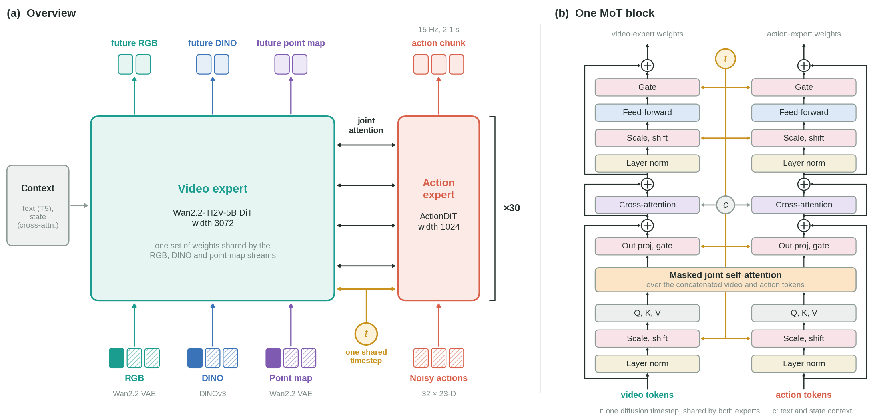
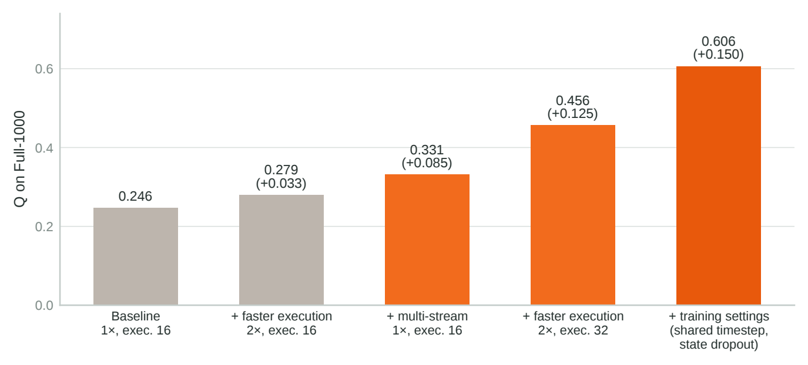

<div align="center">

# Xiaomi CYBERWAM

### Multi-Stream World Action Model for the BEHAVIOR-1K 2026 Challenge

**English** | [中文](./README_zh.md)

[](./LICENSE)


[](https://behavior.stanford.edu/challenge/index.html)

</div>

---

## 🔥 Overview

CYBERWAM is our solution to the **BEHAVIOR-1K 2026 challenge**: 100 full-length household tasks for the
R1 Pro bimanual mobile manipulator. It is a world action model built on
[FastWAM](https://github.com/yuantianyuan01/FastWAM) and the Wan2.2-TI2V-5B video diffusion backbone. Following
[Flex-π](https://github.com/geyan21/flex-pi), it predicts future **RGB video, point maps and DINOv3 features**
together with a 2.1 s chunk of 23-D actions, conditioned on three camera views, the proprioceptive state and a
task prompt.

<div align="center">

</div>

This repository contains the training code, the policy server used for the challenge submission, and one
released checkpoint.

## ✨ Key features

- **Multi-stream prediction.** RGB, point maps and DINO features share one video expert (Wan2.2-TI2V-5B, width
  3072) and are denoised jointly with actions by a 1B action expert (width 1024) in a Mixture-of-Transformers.
- **Train–inference consistent timesteps.** All streams share one diffusion timestep in training, matching the
  path that sampling follows at inference. No extra parameters or compute.
- **Proprioceptive state dropout.** The state is zeroed on 10% of the training samples, so the policy relies
  more on what it sees.
- **Faster execution.** Each predicted 15 Hz action is executed as one 30 Hz control step (2× the demonstrated
  speed), which leaves more time for retries within the challenge time limit.
- **Challenge-ready server.** A WebSocket policy server (`challenge_docker/`) speaks the BEHAVIOR-1K v3.9.3
  protocol, returns 32 control steps per request and validates observation shapes.

## 📊 Results

Q score on all 1000 public test rollouts (100 tasks × 10 instances). Each row changes one thing: rows 2 and 3 are compared with row 1, rows 4 and 5 with the row above.

<div align="center">

</div>

| Step | Model | Speed, execution horizon | Q | Successes |
|---|---|---|---|---|
| 1 Baseline | FastWAM (RGB only) | 1×, 16 | 0.246 | 77 |
| 2 + faster execution | same checkpoint as 1 | 2×, 16 | 0.279 | 124 |
| 3 + multi-stream | CYBERWAM, no training settings | 1×, 16 | 0.331 | 144 |
| 4 + faster execution | same checkpoint as 3 | 2×, 32 | 0.456 | 258 |
| 5 + training settings | **CYBERWAM** (released `model_a`) | 2×, 32 | **0.606** | **412** |

## 📋 Contents

- [Repository layout](#-repository-layout)
- [Released weights](#-released-weights)
- [Installation](#-installation)
- [Prepare base assets](#-prepare-base-assets)
- [Run the policy server](#-run-the-policy-server)
- [Evaluate with the BEHAVIOR-1K evaluator](#-evaluate-with-the-behavior-1k-evaluator)
- [Training](#-training)
- [Tests](#-tests)
- [Acknowledgements](#-acknowledgements)
- [License](#-license)

## 🗂 Repository layout

```text
src/fastwam/            model (Flex / Joint), B1K datasets, trainer, checkpoint contract
configs/                Hydra configs: data/, model/, task/
experiments/b1k_2026/   model factory, policy adapter, simulator/evaluator adapters
challenge_docker/       WebSocket policy server, Dockerfile, model-directory validation
scripts/                training entrypoints, data preparation, norm stats, text-embedding and ActionDiT preprocessing
tests/                  pytest suite
```

## 📦 Released weights

| Checkpoint | Model | Training step | Tasks | Q (Full-1000) | Download |
|---|---|---|---|---|---|
| `model_a` | CYBERWAM | 115,884 | all 100 | 0.606 | coming soon |

```text
model_a/
├── checkpoint.pt             weights + embedded checkpoint contract
├── checkpoint_contract.json  compatibility contract
├── norm_stats.json           normalization statistics (sha256 checked against the contract)
└── model_config.json         task guard: allowed task ids, batch size
```

Verify downloads with the provided `SHA256SUMS.txt`. **Do not edit** `norm_stats.json` or the contract files:
their hashes are checked at startup.

## 🔧 Installation

```bash
conda create -n fastwam python=3.10 -y && conda activate fastwam
pip install torch==2.7.1+cu128 torchvision==0.22.1+cu128 \
  --extra-index-url https://download.pytorch.org/whl/cu128
pip install -e .
pip install websockets==15.0.1 msgpack     # only needed to run the policy server
```

The challenge submission itself ran in Docker with Python 3.11 / torch 2.6.0+cu124 (see below).

## 🧩 Prepare base assets

Download these yourself, subject to their licenses, and place them under `checkpoints/`:

| Asset | Used by |
|---|---|
| Wan2.2-TI2V-5B and Wan2.2 VAE | all models |
| DINOv3 ViT-B/16 (`vit_base_patch16_dinov3.lvd1689m`) | CYBERWAM |
| ActionDiT initialization | training only |
| Wan2.1-T2V-1.3B tokenizer and T5 text embeddings | inference and training |

```bash
export DIFFSYNTH_MODEL_BASE_PATH="$(pwd)/checkpoints/models"

# ActionDiT initialization (training only)
python scripts/preprocess_action_dit_backbone.py \
  --model-config configs/model/fastwam_flex.yaml \
  --output checkpoints/ActionDiT_linear_interp_Wan22_alphascale_1024hdim.pt \
  --device cuda --dtype bfloat16

# T5 text embeddings for the task prompts (Hydra script: pick the task config you will use)
python scripts/precompute_text_embeds.py task=b1k_2026_fastwam_flex_statedrop10_sharedt_ashift5_256gpu
```

## 🦾 Run the policy server

### Docker (recommended)

`challenge_docker/Dockerfile` is reconstructed from the environment of our submitted image; it has not been
rebuilt bit-for-bit, so please verify it on your machine.

```bash
docker build -f challenge_docker/Dockerfile -t fastwam-policy-runtime .

# optional: validate model directories before occupying a GPU
docker run --rm --entrypoint python \
  -v /path/to/weights:/models:ro fastwam-policy-runtime \
  /opt/fastwam/challenge_docker/preflight_models.py /models

docker run --rm --gpus device=0 --network host \
  -v /path/to/runtime-assets:/opt/fastwam/runtime-assets:ro \
  -v /path/to/weights/model_a:/runtime/model:ro \
  fastwam-policy-runtime --host 0.0.0.0 --port 8000

curl http://127.0.0.1:8000/healthz     # wait until the model reports ready
```

`runtime-assets/` follows the layout `models/Wan-AI/Wan2.2-TI2V-5B`, `models/dinov3/...`,
`models/ActionDiT_linear_interp_Wan22_alphascale_1024hdim.pt` and `text_embeds/`.
The entrypoint derives the model configuration from the mounted directory; no model-specific flags are needed.

### Execution settings

| Setting | Default | Meaning |
|---|---|---|
| `FASTWAM_B1K_INFERENCE_STEPS` | 20 | diffusion sampling steps |
| `FASTWAM_TEMPORAL_STRATEGY` | `speed_2x` | each predicted action (15 Hz) is executed as one control step (30 Hz) |
| `FASTWAM_EXECUTE_HORIZON` | 32 | actions executed before re-planning |
| `FASTWAM_RESAMPLING` | `zero_order_hold` | resampling method |

Invalid combinations are rejected at startup.

## 🎯 Evaluate with the BEHAVIOR-1K evaluator

Use the official BEHAVIOR-1K evaluator (v3.9.3) against the running server:

```bash
python -m omnigibson.eval.eval \
  --task-name <task_name> \
  --robot-config <BEHAVIOR-1K>/OmniGibson/omnigibson/eval/r1pro.yaml \
  --env-wrapper omnigibson.eval.wrappers.RGBDFullResWrapper \
  --mode public_test --instance-indices 0 \
  --num-envs 1 --num-rollouts 1 \
  --replay-action-chunk-size 32 \
  --host <server-ip> --port 8000 \
  --output-dir <output-dir> --write-video
```

`RGBDFullResWrapper` is required: the head camera is 720×720 and the wrist cameras 480×480, matching training.
The simulator is installed separately from the BEHAVIOR-1K project.

## 🚀 Training

The released `model_a` is trained with
`configs/task/b1k_2026_fastwam_flex_statedrop10_sharedt_ashift5_256gpu.yaml`.

### Data preparation

The config reads its data from `./data/b1k_2026/` (paths are relative to the repository root).

1. **Demonstrations.** Download the official BEHAVIOR-1K 2026 demonstrations (Hugging Face dataset
   `behavior-1k/2026-challenge-demos`, LeRobot v3.0, 20,000 episodes) to `./data/b1k_2026/v3_source`. We
   used revision `2add61313bac4f1a42363d00ad03bd45949941a8`. CYBERWAM also reads the depth videos
   (`observation.depth_linear.*`) to build the point maps.
2. **Numeric sidecar.** Split the action and state columns into one parquet file per episode; the data
   loader reads these instead of the shared v3 shards:

   ```bash
   python scripts/b1k_2026/build_numeric_sidecar.py build-sidecar \
     --source-root ./data/b1k_2026/v3_source \
     --output-root ./data/b1k_2026/numeric_v3 \
     --source-revision 2add61313bac4f1a42363d00ad03bd45949941a8
   python scripts/b1k_2026/build_numeric_sidecar.py verify-sidecar \
     --sidecar-root ./data/b1k_2026/numeric_v3 --source-root ./data/b1k_2026/v3_source
   ```

   To skip this step, set `numeric_dataset_root: null`; the loader then reads the v3 shards directly.
3. **Normalization statistics.** To reproduce `model_a`, copy its `norm_stats.json` to
   `./data/b1k_2026/norm_stats.json`. To compute them yourself:

   ```bash
   python scripts/b1k_2026/compute_norm_stats.py \
     --dataset-root ./data/b1k_2026/numeric_v3 --output ./data/b1k_2026/norm_stats.json
   ```

4. **Text embeddings.** Precompute the T5 embeddings of the task prompts as in
   [Prepare base assets](#-prepare-base-assets); they are written to `./data/b1k_2026/text_cache`.

### Launch

Training uses DeepSpeed ZeRO-1. `<N>` is the number of GPUs per node; set `NNODES`, `NODE_RANK`, `MASTER_ADDR`
and `MASTER_PORT` for multi-node runs.

```bash
bash scripts/train_zero1.sh <N> task=b1k_2026_fastwam_flex_statedrop10_sharedt_ashift5_256gpu
```

`model_a` was trained with a per-GPU batch of 32 for 30 epochs, and is the checkpoint at epoch 27 (step 115,884).

**What an epoch means here.** Training windows start every 6 frames of each episode
(`window_start_stride: 6` in `configs/data/b1k_2026_direct_video.yaml`), so the 210.9M recorded frames give about
35.2M windows, i.e. the data is down-sampled 6x. One epoch is one pass over these windows, and 30 epochs correspond to
about 5 passes over the full frame set.

**Changing the number of GPUs.** The step count in the config is derived from the original GPU count:
`max_steps: 128760` in the task config takes precedence over `num_epochs`, and the learning-rate schedule
(`lr_warmup_steps: 1288`, cosine decay) is defined in steps. With a different number of GPUs, keep the global batch
(GPUs x 32 x `gradient_accumulation_steps`) the same, or rescale `max_steps` and `lr_warmup_steps` by the same factor.

Training writes a checkpoint contract next to every checkpoint, and resuming validates it.

## 🧪 Tests

```bash
pip install pytest
PYTHONPATH=.:src pytest tests
```

## 🙏 Acknowledgements

CYBERWAM builds on [FastWAM](https://github.com/yuantianyuan01/FastWAM) for the codebase,
[Wan2.2](https://github.com/Wan-Video/Wan2.2) for the video backbone and VAE,
[DINOv3](https://github.com/facebookresearch/dinov3) for semantic features, and
[BEHAVIOR-1K](https://behavior.stanford.edu/) for the benchmark and data. The multi-stream design follows
[Flex-π](https://github.com/geyan21/flex-pi). We thank these teams for releasing their work.

## 📜 License

Code and released weights are under the [Apache License 2.0](./LICENSE). Parts of the code are derived from FastWAM (MIT) and from
Wan2.2 / DiffSynth-Studio (Apache-2.0), and some files keep their original Apache-2.0 or BSD-3-Clause headers; the weights are
fine-tuned from Wan2.2-TI2V-5B (Apache-2.0). See [NOTICE.md](./NOTICE.md) and `third_party_licenses/`. Third-party assets (Wan2.2,
DINOv3, the BEHAVIOR-1K simulator and data) are not included in this repository.
