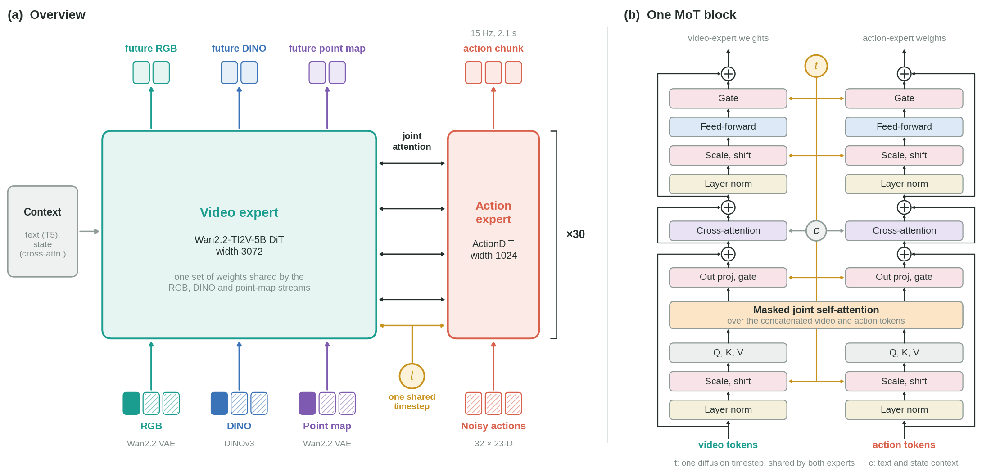
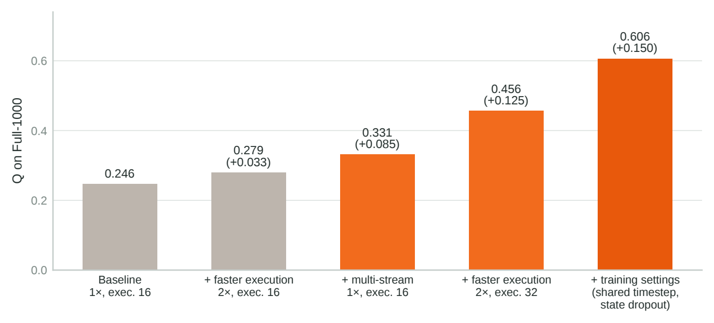

<div align="center">

# Xiaomi CYBERWAM

### 面向 BEHAVIOR-1K 2026 挑战赛的多流世界动作模型

[English](./README.md) | **中文**

[](./LICENSE)


[](https://behavior.stanford.edu/challenge/index.html)

</div>

---

## 🔥 简介

CYBERWAM 是我们参加 **BEHAVIOR-1K 2026 挑战赛**的方案。比赛包含 100 个全长家务任务,机器人是双臂移动底盘的 R1 Pro。
CYBERWAM 是一个世界动作模型,基于 [FastWAM](https://github.com/yuantianyuan01/FastWAM) 和 Wan2.2-TI2V-5B 视频扩散骨干。
参考 [Flex-π](https://github.com/geyan21/flex-pi),它在预测 2.1 秒、23 维动作序列的同时,还预测未来的 **RGB 视频、点云图和
DINOv3 特征**;输入是三路相机图像、本体状态和任务提示。

<div align="center">

</div>

本仓库包含训练代码、比赛提交时使用的策略服务,以及一个开源权重。

## ✨ 特点

- **多流预测。** RGB、点云图和 DINO 特征共用一个视频专家(Wan2.2-TI2V-5B,宽度 3072),与 1B 的动作专家(宽度 1024)
  在 Mixture-of-Transformers 中一起对动作去噪。
- **训练与推理一致的时间步。** 训练时所有 stream 共用一个扩散时间步,与推理时采样走的路径一致,不增加参数和计算量。
- **本体状态 dropout。** 训练时 10% 的样本把本体状态置零,让策略更多依赖视觉信息。
- **加速执行。** 每个 15 Hz 的预测动作只执行一个 30 Hz 控制步(示教速度的 2 倍),在比赛的时间限制内留出更多重试时间。
- **面向比赛的服务。** `challenge_docker/` 提供遵循 BEHAVIOR-1K v3.9.3 协议的 WebSocket 策略服务,每次请求返回 32 个控制步,
  并校验观测形状。

## 📊 结果

在全部 1000 个公开测试 rollout(100 个任务 × 10 个实例)上的 Q 分数。每一行只改动一项:第 2、3 行与第 1 行比较,第 4、5 行与上一行比较。

<div align="center">

</div>

| 步骤 | 模型 | 速度、执行步数 | Q | 成功数 |
|---|---|---|---|---|
| 1 Baseline | FastWAM(只用 RGB) | 1×、16 | 0.246 | 77 |
| 2 + 加速执行 | 与 1 相同的 checkpoint | 2×、16 | 0.279 | 124 |
| 3 + 多流 | CYBERWAM,不加训练设置 | 1×、16 | 0.331 | 144 |
| 4 + 加速执行 | 与 3 相同的 checkpoint | 2×、32 | 0.456 | 258 |
| 5 + 训练设置 | **CYBERWAM**(开源的 `model_a`) | 2×、32 | **0.606** | **412** |

## 📋 目录

- [代码结构](#-代码结构)
- [开源权重](#-开源权重)
- [安装](#-安装)
- [准备基础资源](#-准备基础资源)
- [启动策略服务](#-启动策略服务)
- [使用官方评测器评测](#-使用官方评测器评测)
- [训练](#-训练)
- [测试](#-测试)
- [致谢](#-致谢)
- [许可证](#-许可证)

## 🗂 代码结构

```text
src/fastwam/            模型(Flex / Joint)、B1K 数据集、训练器、checkpoint 契约
configs/                Hydra 配置:data/、model/、task/
experiments/b1k_2026/   模型构建、策略适配、仿真/评测适配
challenge_docker/       WebSocket 策略服务、Dockerfile、模型目录校验
scripts/                训练入口、数据准备、归一化统计、文本嵌入与 ActionDiT 预处理
tests/                  pytest 测试
```

## 📦 开源权重

| 权重 | 模型 | 训练步数 | 任务 | Q(Full-1000) | 下载 |
|---|---|---|---|---|---|
| `model_a` | CYBERWAM | 115,884 | 全部 100 个 | 0.606 | 即将发布 |

```text
model_a/
├── checkpoint.pt             权重(内嵌 checkpoint 契约)
├── checkpoint_contract.json  兼容性契约
├── norm_stats.json           归一化统计(其 sha256 会与契约核对)
└── model_config.json         任务限制:允许的任务 id、batch size
```

下载后请用 `SHA256SUMS.txt` 校验。**请勿修改** `norm_stats.json` 和契约文件,启动时会校验它们的哈希。

## 🔧 安装

```bash
conda create -n fastwam python=3.10 -y && conda activate fastwam
pip install torch==2.7.1+cu128 torchvision==0.22.1+cu128 \
  --extra-index-url https://download.pytorch.org/whl/cu128
pip install -e .
pip install websockets==15.0.1 msgpack     # 仅运行策略服务时需要
```

比赛提交的镜像实际使用 Python 3.11 / torch 2.6.0+cu124(见下文 Docker)。

## 🧩 准备基础资源

以下资源请自行下载并遵守各自许可,放到 `checkpoints/` 下:

| 资源 | 用途 |
|---|---|
| Wan2.2-TI2V-5B 与 Wan2.2 VAE | 所有模型 |
| DINOv3 ViT-B/16(`vit_base_patch16_dinov3.lvd1689m`) | CYBERWAM |
| ActionDiT 初始化权重 | 仅训练 |
| Wan2.1-T2V-1.3B 分词器与 T5 文本嵌入 | 推理和训练 |

```bash
export DIFFSYNTH_MODEL_BASE_PATH="$(pwd)/checkpoints/models"

# 生成 ActionDiT 初始化权重(仅训练需要)
python scripts/preprocess_action_dit_backbone.py \
  --model-config configs/model/fastwam_flex.yaml \
  --output checkpoints/ActionDiT_linear_interp_Wan22_alphascale_1024hdim.pt \
  --device cuda --dtype bfloat16

# 预计算任务提示的 T5 文本嵌入(Hydra 脚本,选择你要用的 task 配置)
python scripts/precompute_text_embeds.py task=b1k_2026_fastwam_flex_statedrop10_sharedt_ashift5_256gpu
```

## 🦾 启动策略服务

### Docker(推荐)

`challenge_docker/Dockerfile` 根据我们提交镜像的环境重建,尚未做逐字节一致的重新构建,请在你的机器上自行验证。

```bash
docker build -f challenge_docker/Dockerfile -t fastwam-policy-runtime .

# 可选:占用 GPU 前先校验模型目录
docker run --rm --entrypoint python \
  -v /path/to/weights:/models:ro fastwam-policy-runtime \
  /opt/fastwam/challenge_docker/preflight_models.py /models

docker run --rm --gpus device=0 --network host \
  -v /path/to/runtime-assets:/opt/fastwam/runtime-assets:ro \
  -v /path/to/weights/model_a:/runtime/model:ro \
  fastwam-policy-runtime --host 0.0.0.0 --port 8000

curl http://127.0.0.1:8000/healthz     # 等待模型加载完成
```

`runtime-assets/` 的目录结构:`models/Wan-AI/Wan2.2-TI2V-5B`、`models/dinov3/...`、
`models/ActionDiT_linear_interp_Wan22_alphascale_1024hdim.pt` 和 `text_embeds/`。
入口脚本会根据挂载的模型目录自动推导配置,无需额外的模型参数。

### 执行参数

| 参数 | 默认值 | 含义 |
|---|---|---|
| `FASTWAM_B1K_INFERENCE_STEPS` | 20 | 扩散采样步数 |
| `FASTWAM_TEMPORAL_STRATEGY` | `speed_2x` | 每个预测动作(15 Hz)作为一个控制步(30 Hz)执行 |
| `FASTWAM_EXECUTE_HORIZON` | 32 | 重新规划前执行的动作数 |
| `FASTWAM_RESAMPLING` | `zero_order_hold` | 重采样方式 |

不合法的参数组合会在启动时直接报错。

## 🎯 使用官方评测器评测

用官方 BEHAVIOR-1K 评测器(v3.9.3)连接正在运行的服务:

```bash
python -m omnigibson.eval.eval \
  --task-name <task_name> \
  --robot-config <BEHAVIOR-1K>/OmniGibson/omnigibson/eval/r1pro.yaml \
  --env-wrapper omnigibson.eval.wrappers.RGBDFullResWrapper \
  --mode public_test --instance-indices 0 \
  --num-envs 1 --num-rollouts 1 \
  --replay-action-chunk-size 32 \
  --host <server-ip> --port 8000 \
  --output-dir <output-dir> --write-video
```

必须使用 `RGBDFullResWrapper`:头部相机 720×720,腕部相机 480×480,与训练分辨率一致。仿真器请按 BEHAVIOR-1K 项目的说明另行安装。

## 🚀 训练

开源的 `model_a` 使用 `configs/task/b1k_2026_fastwam_flex_statedrop10_sharedt_ashift5_256gpu.yaml` 训练。

### 数据准备

该配置读取 `./data/b1k_2026/` 下的数据(路径相对于仓库根目录)。

1. **演示数据。** 下载官方 BEHAVIOR-1K 2026 演示数据(Hugging Face 数据集 `behavior-1k/2026-challenge-demos`,
   LeRobot v3.0 格式,20,000 条 episode)到 `./data/b1k_2026/v3_source`。我们使用的版本是
   `2add61313bac4f1a42363d00ad03bd45949941a8`。CYBERWAM 还会读取深度视频(`observation.depth_linear.*`)来生成点云图。
2. **数值 sidecar。** 把动作和状态列拆成每条 episode 一个 parquet 文件,数据加载器读取它们,而不是读取共享的 v3 分片:

   ```bash
   python scripts/b1k_2026/build_numeric_sidecar.py build-sidecar \
     --source-root ./data/b1k_2026/v3_source \
     --output-root ./data/b1k_2026/numeric_v3 \
     --source-revision 2add61313bac4f1a42363d00ad03bd45949941a8
   python scripts/b1k_2026/build_numeric_sidecar.py verify-sidecar \
     --sidecar-root ./data/b1k_2026/numeric_v3 --source-root ./data/b1k_2026/v3_source
   ```

   如果跳过这一步,把 `numeric_dataset_root` 设为 `null`,加载器会直接读取 v3 分片。
3. **归一化统计。** 复现 `model_a` 时,把它的 `norm_stats.json` 复制到 `./data/b1k_2026/norm_stats.json`。
   也可以自己计算:

   ```bash
   python scripts/b1k_2026/compute_norm_stats.py \
     --dataset-root ./data/b1k_2026/numeric_v3 --output ./data/b1k_2026/norm_stats.json
   ```

4. **文本嵌入。** 按[准备基础资源](#-准备基础资源)预计算任务提示的 T5 嵌入,结果写入 `./data/b1k_2026/text_cache`。

### 启动训练

使用 DeepSpeed ZeRO-1。`<N>` 为每节点 GPU 数;多机时设置 `NNODES`、`NODE_RANK`、`MASTER_ADDR`、`MASTER_PORT`。

```bash
bash scripts/train_zero1.sh <N> task=b1k_2026_fastwam_flex_statedrop10_sharedt_ashift5_256gpu
```

`model_a` 每卡 batch 为 32,训练 30 个 epoch,取的是第 27 个 epoch(第 115,884 步)的 checkpoint。

**这里的 epoch 指什么。** 训练窗口在每条 episode 里每隔 6 帧取一个起点(`configs/data/b1k_2026_direct_video.yaml` 中的
`window_start_stride: 6`),所以 2.109 亿帧只产生约 3,520 万个窗口,相当于对数据做了 6 倍降采样。一个 epoch 是把这些窗口过一遍,
30 个 epoch 折合成对全部帧大约过 5 遍。

**更换 GPU 数量。** 配置里的步数是按原来的 GPU 数算出来的:任务配置中的 `max_steps: 128760` 优先于 `num_epochs`,
学习率计划(`lr_warmup_steps: 1288`,余弦衰减)也是按步数定义的。换了 GPU 数后,请保持全局 batch(GPU 数 x 32 x
`gradient_accumulation_steps`)不变,或者按同样的比例调整 `max_steps` 和 `lr_warmup_steps`。

训练会在每个 checkpoint 旁写入契约文件,续训时会校验。

## 🧪 测试

```bash
pip install pytest
PYTHONPATH=.:src pytest tests
```

## 🙏 致谢

CYBERWAM 的代码基于 [FastWAM](https://github.com/yuantianyuan01/FastWAM),视频骨干和 VAE 来自
[Wan2.2](https://github.com/Wan-Video/Wan2.2),语义特征来自 [DINOv3](https://github.com/facebookresearch/dinov3),
基准和数据来自 [BEHAVIOR-1K](https://behavior.stanford.edu/),多流设计参考了 [Flex-π](https://github.com/geyan21/flex-pi)。
感谢这些团队开源他们的工作。

## 📜 许可证

代码和开源权重基于 [Apache 许可证 2.0](./LICENSE) 发布。部分代码改编自 FastWAM(MIT)以及 Wan2.2 / DiffSynth-Studio(Apache-2.0),
部分文件保留原有的 Apache-2.0 或 BSD-3-Clause 许可头,权重由 Wan2.2-TI2V-5B(Apache-2.0)微调得到;详见 [NOTICE.md](./NOTICE.md)
和 `third_party_licenses/`。第三方资源(Wan2.2、DINOv3、BEHAVIOR-1K 仿真器与数据)不包含在本仓库中。
